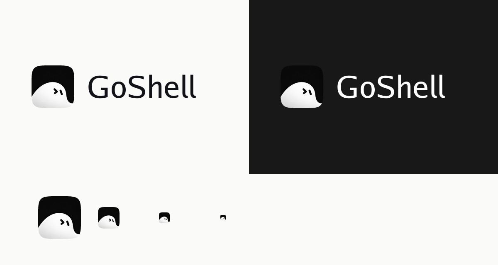
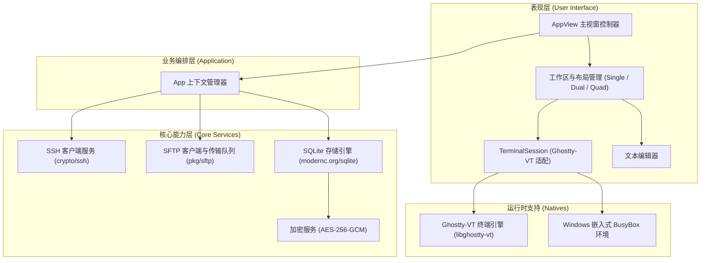

<p align="center">
  
</p>

<h1 align="center">GoShell</h1>

<p align="center">
  <strong>基于 Go 与 MyGo 构建的轻量跨平台桌面 SSH 终端与主机管理工具</strong>
</p>

<p align="center">
  
  
  
  
  
</p>

<p align="center">
  
</p>

---

## 项目简介

GoShell 是一个基于 Go 语言和桌面 GUI 框架 [MyGo](https://github.com/egoist/mygo) 开发的跨平台桌面终端与远程主机管理工具。该项目内嵌 Ghostty-VT 原生终端虚拟仿真引擎，不依赖 Electron 或 Web 渲染技术栈，具备内存占用低、启动迅速及跨平台行为一致的特点。

---

## 主要特性

- **终端仿真与文本渲染**：集成 Ghostty-VT 终端引擎，支持 24 位真彩色（True Color）、全套 VT 转义序列及平滑文本滚动。
- **本地终端环境支持**：
  - **Windows**：内置嵌入式 Busybox 环境，同时支持切换为 PowerShell 或 CMD。
  - **macOS / Linux**：默认接入系统登录 Shell（如 Zsh、Bash）。
- **SSH 会话与主机管理**：
  - 提供主机列表展示与分组归类功能。
  - 支持快捷解析 `ssh user@host:port` 格式的连接命令。
  - 支持基于密码与私钥文件（含私钥密码）的身份认证。
- **多窗格与多标签工作区**：
  - 支持单标签视窗、左右双分屏（Dual Split）与四宫格（2×2 Quad Grid）等视窗布局，支持快捷切换焦点。
  - 标签页支持重命名以及关闭确认拦截，避免误操作中断连接。
- **SFTP 文件管理与远程编辑**：
  - 侧边栏提供主机列表与远程文件目录树双视图。
  - 支持文件与目录的上传、下载及后台传输任务进度管理。
  - 内置轻量文本编辑器，支持直接打开远程文本文件并同步保存写回服务器。
- **凭据加密与本地存储**：
  - 基于本地 SQLite 进行元数据持久化。
  - 敏感凭据（密码、私钥）统一采用 AES-256-GCM 算法加密存储，主密钥由本地受控管理，不包含明文凭证。
- **跨平台分发支持**：
  - 适配 macOS（Apple Silicon 与 Intel x86_64）、Windows（AMD64 与 ARM64）及 Linux 平台。
  - 终端引擎动态库与运行时资源打包内嵌，支持单文件分发与离线环境使用。

---

## 系统架构

GoShell 采用分层解耦的模块化设计：



---

## 快速上手

### 环境要求

- **Go**：`1.24` 或更高版本
- **CGO**：无需外部 CGO 依赖，纯 Go 编译并通过运行时动态装载底层 VT 引擎

### 本地运行

在项目根目录下执行以下命令直接启动运行：

```bash
make run
```

---

## 构建与打包

项目使用 `Makefile` 管理各平台的构建和交叉编译流程：

```bash
# 查看所有可用构建命令说明
make help
```

### 1. 本地主机编译
```bash
make build
# 产物输出至: bin/goshell
```

### 2. Windows 平台编译与打包
```bash
# 编译 Windows 64位 GUI 程序（包含程序图标与清单文件）
make build-windows

# 编译 Windows ARM64 程序
make build-windows-arm64

# 打包为离线 Zip 压缩包（包含可执行程序与运行时动态库）
make package-windows
```

### 3. macOS 平台编译
```bash
make build-darwin
# 产物输出至: bin/GoShell-darwin 及配套 libghostty-vt.dylib
```

### 4. Linux 平台编译
```bash
make build-linux
# 产物输出至: bin/GoShell-linux 及配套 libghostty-vt.so
```

### 5. 更新原生引擎库
如需重新下载各平台对应的 Ghostty 终端动态库，可执行：
```bash
make fetch-natives
```

---

## 项目结构

```text
goshell/
├── cmd/
│   └── goshell/             # 桌面程序入口 (main.go, 窗口初始化与事件循环)
├── internal/
│   ├── app/                 # 应用程序上下文、状态维护与初始化数据
│   ├── core/                # 核心功能模块
│   │   ├── model/           # 数据模型定义
│   │   ├── security/        # 主密钥管理与 AES-256-GCM 加解密服务
│   │   ├── storage/         # SQLite 数据持久化实现
│   │   ├── ssh/             # SSH 连接与 PTY 会话实现
│   │   ├── sftp/            # SFTP 客户端与远程文件操作
│   │   └── transfer/        # 后台文件传输任务调度
│   └── ui/                  # 桌面 UI 实现 (基于 MyGo)
│       ├── app_view.go      # 主界面布局、事件响应与窗口控制
│       ├── session.go       # 终端会话与 Ghostty-VT 状态流转
│       ├── editor_tab.go    # 远程文件文本编辑器
│       ├── ssh_cmd_parser.go# SSH 命令行解析器
│       └── theme.go         # 界面配色与布局常量
├── assets/
│   ├── brand/               # 品牌视觉资源 (图标、Logo 等)
│   ├── fonts/               # 终端字体文件
│   └── natives/             # 各操作系统对应的终端引擎动态库及 Busybox 程序
├── tools/
│   ├── brandgen/            # 品牌资源生成工具
│   └── fetch_natives/       # 跨平台动态库同步脚本
├── Makefile                 # 构建、测试与打包指令
├── mygo.json                # 桌面应用配置清单
└── go.mod                   # 模块依赖描述文件
```

---

## 数据安全说明

GoShell 的全部配置与连接信息仅保存在用户本地设备中：

- **数据存储路径**：`~/.goshell/`
  - `goshell.db`：SQLite 数据库文件，用于持久化主机配置与连接历史。
  - `master.key`：本地生成的 AES-256 主密钥文件。
- **注意事项**：主机密码及私钥凭据均使用 `master.key` 加密。若该密钥文件损坏或丢失，将无法解密先前已保存的连接凭据，请注意妥善备份。

---

## 许可证

本项目基于 [MIT 许可证](LICENSE) 发布。终端仿真引擎遵循 Ghostty 的开源协议，字标字体授权详情请参考 `assets/brand/FONT-LICENSE.txt`。
