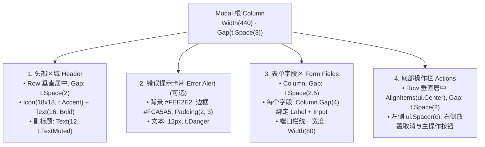

# GoShell UI 设计规范与弹窗标准 (UI Guidelines)

本文档记录了 GoShell 桌面端界面的设计语言、排版阶梯以及弹窗（Modal / Dialog）的布局规范，确保后续新功能与交互组件保持高度一致的视觉质感。

---

## 一、设计风格与核心原则

- **视觉风格**：采用现代化极简桌面质感（参考 GitHub / Linear / Shadcn 设计语言）。
- **空间克制**：基准留白 `t.Spacing = 4`，基础圆角 `t.Radius = 6`。
- **色彩规范**：严格使用主题语义色（`t.Text`、`t.TextMuted`、`t.Accent`、`t.Danger`），避免组件内散落硬编码 HEX 颜色。
- **垂直韵律**：表单组件遵循「紧凑成组、模块分明」的垂直节奏，标签（Label）与对应输入框（Input）强绑定成组。

---

## 二、弹窗（Modal）分类与尺寸规范

为了保证各类弹窗视觉重心的稳定性，弹窗宽度根据使用场景划分为固定梯队：

| 弹窗类型 | 推荐宽度 | 典型场景 | 示例 |
| :--- | :--- | :--- | :--- |
| **标准表单弹窗 (Form Dialog)** | **`440px`** | 多字段输入、双栏组合输入、凭据配置等 | 添加/编辑主机、快速连接 |
| **紧凑型输入弹窗 (Compact Dialog)** | **`380px`** | 单字段输入、重命名、确认带输入 | 重命名标签页 |
| **信息展示型弹窗 (Info Dialog)** | **`360px`** | 关于页面、版权声明、简单提示 | 关于 GoShell |

---

## 三、字体与文字层级 (Typography)

| 层级 | 字号 (FontSize) | 字重 (Weight) | 颜色 (Color) | 应用场景 |
| :--- | :--- | :--- | :--- | :--- |
| **弹窗主标题** | `16` | **Bold** | `t.Text` | 弹窗顶部标题 |
| **说明/副标题** | `12` | Regular | `t.TextMuted` | 标题下方的解释性描述 |
| **表单 Label** | `12` | **Bold** | `t.Text` | 输入框上方的字段标签 |
| **输入框文本** | `12` ~ `13` | Regular | `t.Text` | 输入框实际录入内容 |
| **辅助说明/Badge** | `11` | Regular/Bold | `t.TextMuted` | 选项切换提示、备注说明 |
| **卡片警告文字** | `12` | Regular | `t.Danger` | 表单校验错误提示文案 |

---

## 四、表单布局节奏与间距规范



### 1. 字段封装（FormField 规范）
每个表单输入项必须使用独立垂直容器绑定，间距固定为 `4px`，杜绝 Label 与输入框游离在根容器：
```go
ui.Column(c).Gap(4).Children(func() {
    ui.Text(c, "主机地址").FontSize(12).Bold().TextColor(t.Text)
    ui.TextInput(c, &v.formAddress).
        Placeholder("IP 或域名，如 192.168.1.100").
        OnSubmit(func() { v.submit() })
})
```

### 2. 多栏对齐（Grid / Split）
- **地址与端口分栏**：
  - 主机地址：`ui.Column(c).Grow(1).Gap(4)`
  - 端口栏：固定宽度 `ui.Column(c).Width(80).Gap(4)`
- **字段水平间距**：统一为 `Gap(t.Space(2))`。

### 3. 输入占位符与键盘交互
- 所有输入框均需提供清晰语义的 `Placeholder`。
- 表单输入框应统一挂载 `.OnSubmit` 回车提交事件，方便用户连续盲打后直接提交。

---

## 五、状态与反馈规范 (Alerts)

表单发生校验错误时，统一采用微警告卡片，严禁直接堆放无容器的孤立红字：
```go
if v.errorMessage != "" {
    ui.Row(c).
        Background(ui.Hex("#FEE2E2")).
        Border(1, ui.Hex("#FCA5A5")).
        Padding(t.Space(2), t.Space(3)).
        Radius(t.Radius).
        Children(func() {
            ui.Text(c, v.errorMessage).FontSize(12).TextColor(t.Danger)
        })
}
```

---

## 六、底部操作栏规范 (Footer Actions)

- 底部按钮栏必须开启垂直居中：`.AlignItems(ui.Center)`。
- 按钮间隙统一为 `t.Space(2)`（8px）。
- 按钮对齐遵循右对齐模式（通过 `ui.Spacer(c)` 推至右侧）。
- 次要操作（如「取消」）在左，主要确定操作（如「保存配置」、「连接」）在右。

---

## 七、标准弹窗代码模板 (Code Template)

在编写新的弹窗时，请参考以下标准模板结构：

```go
func (v *AppView) renderStandardModal(c *ui.Context, t *ui.Theme) {
	ui.Modal(c, &v.modalOpen, func() {
		ui.Column(c).Width(440).Gap(t.Space(3)).Children(func() {
			// 1. 标题区
			ui.Row(c).AlignItems(ui.Center).Gap(t.Space(2)).Children(func() {
				ui.Icon(c, IconServer).Width(18).Height(18).TextColor(t.Accent)
				ui.Text(c, "弹窗标题").FontSize(16).Bold().TextColor(t.Text)
			})
			ui.Text(c, "简要描述此弹窗的操作目标与注意事项。").FontSize(12).TextColor(t.TextMuted)

			// 2. 错误警示卡片 (按需展示)
			if v.errorMsg != "" {
				ui.Row(c).Background(ui.Hex("#FEE2E2")).Border(1, ui.Hex("#FCA5A5")).
					Padding(t.Space(2), t.Space(3)).Radius(t.Radius).Children(func() {
					ui.Text(c, v.errorMsg).FontSize(12).TextColor(t.Danger)
				})
			}

			// 3. 表单内容区
			ui.Column(c).Gap(t.Space(2.5)).Children(func() {
				// 单行字段
				ui.Column(c).Gap(4).Children(func() {
					ui.Text(c, "字段标签").FontSize(12).Bold().TextColor(t.Text)
					ui.TextInput(c, &v.myInput).Placeholder("输入提示...").OnSubmit(func() {
						v.submitForm()
					})
				})

				// 双栏分列字段
				ui.Row(c).Gap(t.Space(2)).Children(func() {
					ui.Column(c).Grow(1).Gap(4).Children(func() {
						ui.Text(c, "主要字段").FontSize(12).Bold().TextColor(t.Text)
						ui.TextInput(c, &v.mainField).Placeholder("...").OnSubmit(func() {
							v.submitForm()
						})
					})
					ui.Column(c).Width(80).Gap(4).Children(func() {
						ui.Text(c, "固定宽字段").FontSize(12).Bold().TextColor(t.Text)
						ui.TextInput(c, &v.fixedField).Placeholder("...").OnSubmit(func() {
							v.submitForm()
						})
					})
				})
			})

			// 4. 底部操作栏
			ui.Row(c).AlignItems(ui.Center).Gap(t.Space(2)).Children(func() {
				ui.Spacer(c)
				if ui.Button(c, "取消").Clicked() {
					v.modalOpen = false
				}
				if ui.PrimaryButton(c, "确认操作").Clicked() {
					v.submitForm()
				}
			})
		})
	})
}
```
